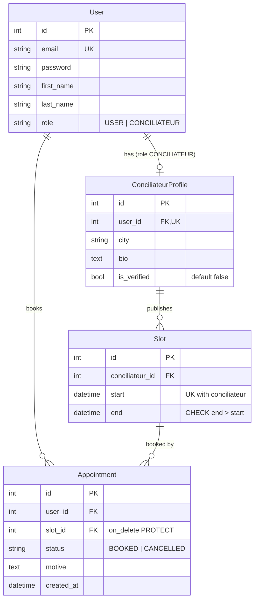

# Backend

Django REST Framework API, stateless (JWT), sqlite3.

```bash
pip install -r requirements.txt
python manage.py migrate
python manage.py runserver                      # Swagger: http://localhost:8000/api/docs/
python manage.py runserver --authorize-all=yes  # testing: unverified conciliateurs are visible/bookable
python manage.py test
```

Conciliateurs register unverified; validate them from the Django admin (`createsuperuser`, then `/admin/`).
Cancel/reschedule window: `CANCELLATION_WINDOW_HOURS` in `config/settings.py`.

## Database schema

Hand-written from the models: update it when a model changes.



`Appointment.slot` is unique among `BOOKED` rows only (a cancelled one frees the slot).

Inspect the real database:

```bash
sqlite3 db.sqlite3 .schema                          # actual tables
python manage.py sqlmigrate appointments 0001       # SQL of a migration
python manage.py showmigrations                     # applied / pending
```
