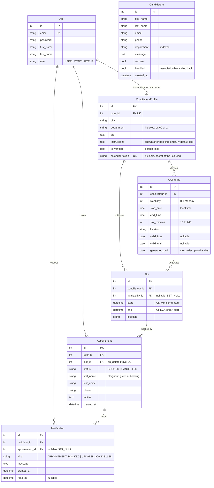

# Backend

Django REST Framework API, stateless (JWT), sqlite3.

```bash
pip install -r requirements.txt
cp .env.example .env                            # local config (git-ignored); set SECRET_KEY
python manage.py migrate
python manage.py runserver                      # Swagger: http://localhost:8000/api/docs/
python manage.py runserver --authorize-all=yes  # testing: unverified conciliateurs are visible/bookable
python manage.py test
```

Conciliateurs have no public registration: create them with
`python manage.py create_conciliateur EMAIL --password ... --city Lyon --department 69` (verified by default, `--unverified` otherwise),
or from the Django admin (`createsuperuser`, then `/admin/`). The admin also lists the `Candidature`s (people who want to become conciliateurs).
## Configuration

All environment-specific settings come from environment variables; for local work they are read from `backend/.env`
(copy `.env.example`, which documents every variable). Real environment variables always win over the file.

| Variable | Default | Notes |
|---|---|---|
| `SECRET_KEY` | none | **Required** unless `DEBUG=true` (Django refuses to start). Never commit it. |
| `DEBUG` | `false` | Secure by default; `.env.example` sets `true` for local work. |
| `ALLOWED_HOSTS` | empty | Comma-separated. With `DEBUG=true` and empty, only localhost works. |
| `CORS_ALLOWED_ORIGINS` | `localhost:3000` | Front origins allowed to call the API from a browser. |
| `CSRF_TRUSTED_ORIGINS` | empty | Only for the Django admin behind an HTTPS domain. |
| `DATABASE_PATH` | `backend/db.sqlite3` | sqlite file (the Docker image uses `/data/db.sqlite3`). |
| `EMAIL_HOST`, `EMAIL_PORT`, `EMAIL_HOST_USER`, `EMAIL_HOST_PASSWORD`, `DEFAULT_FROM_EMAIL` | console e-mails | Alert e-mails go through SMTP once `EMAIL_HOST` is set. |
| `SECURE_SSL_REDIRECT`, `SECURE_HSTS_SECONDS`, `BEHIND_HTTPS_PROXY` | off | Production hardening, see `.env.example`. |

Check a production-like configuration with `python manage.py check --deploy`.

## Deployment

`Dockerfile` (gunicorn + whitenoise for static files, runs `migrate` at start, sqlite in the `/data` volume) and, at the repository root,
`docker-compose.yml` for a production-like local run: `docker compose up --build`. Static files are served by whitenoise
(`collectstatic` runs at image build time). sqlite is fine for a demo or a small deployment; plan a proper database and backups before real traffic.

Other settings worth knowing (`config/settings.py`): `CANCELLATION_WINDOW_HOURS` (24), `AVAILABILITY_HORIZON_WEEKS` (8),
`LOCAL_TIME_ZONE` (Europe/Paris, used by recurring availabilities) and `DEFAULT_APPOINTMENT_INSTRUCTIONS`.

## Database schema

Hand-written from the models: update it when a model changes.



`Appointment.slot` is unique among `BOOKED` rows only (a cancelled one frees the slot).

Inspect the real database:

```bash
sqlite3 db.sqlite3 .schema                          # actual tables
python manage.py sqlmigrate appointments 0001       # SQL of a migration
python manage.py showmigrations                     # applied / pending
```
