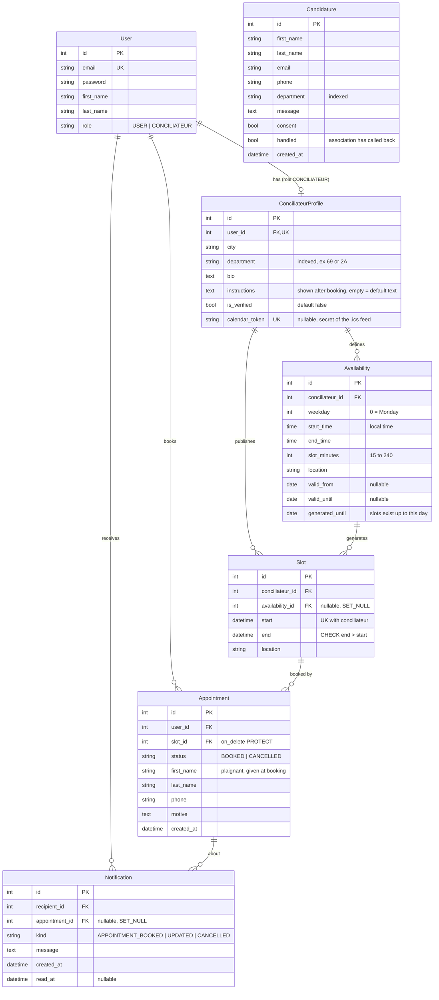

# Backend

Django REST Framework API, stateless (JWT), sqlite3.

```bash
pip install -r requirements.txt
python manage.py migrate
python manage.py runserver                      # Swagger: http://localhost:8000/api/docs/
python manage.py runserver --authorize-all=yes  # testing: unverified conciliateurs are visible/bookable
python manage.py test
```

Conciliateurs have no public registration: create them with
`python manage.py create_conciliateur EMAIL --password ... --city Lyon --department 69` (verified by default, `--unverified` otherwise),
or from the Django admin (`createsuperuser`, then `/admin/`). The admin also lists the `Candidature`s (people who want to become conciliateurs).
Settings worth knowing (`config/settings.py`): `CANCELLATION_WINDOW_HOURS` (24), `AVAILABILITY_HORIZON_WEEKS` (8),
`LOCAL_TIME_ZONE` (Europe/Paris, used by recurring availabilities), `DEFAULT_APPOINTMENT_INSTRUCTIONS`, env var `CORS_ALLOWED_ORIGINS` (default: localhost:3000).

Alert e-mails (conciliateur notified on booking/change/cancellation) are printed in the console by default. For real SMTP set
`EMAIL_HOST`, `EMAIL_PORT` (587), `EMAIL_HOST_USER`, `EMAIL_HOST_PASSWORD` and `DEFAULT_FROM_EMAIL`.

## Database schema

Hand-written from the models: update it when a model changes.



`Appointment.slot` is unique among `BOOKED` rows only (a cancelled one frees the slot).

Inspect the real database:

```bash
sqlite3 db.sqlite3 .schema                          # actual tables
python manage.py sqlmigrate appointments 0001       # SQL of a migration
python manage.py showmigrations                     # applied / pending
```
